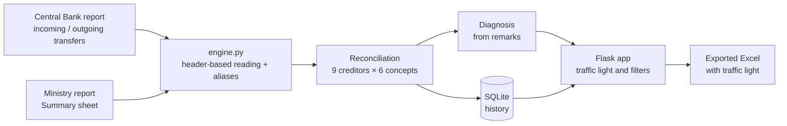

# 🏦 Public External Debt Reconciliation Automation

**Python · Flask · openpyxl · SQLite** — 🇪🇸 [Versión en español](README.md)

A tool that reconciles, every month, the **public external debt payments** recorded by the Central Bank against the Ministry of Finance report: it cross-checks **9 creditors × 6 payment concepts**, flags what matches with a traffic light and automatically explains why the rest does not.

> **Real case, synthetic data.** I built this solution at the **Central Bank of Ecuador**, where I work as a Liquidity Operations Analyst, to replace a manual Excel cross-check. This repository is a **rebuilt public version**: same business logic, but with invented reports and no institutional paths, names or data. The internal version runs locally at the bank and its information is confidential.


---

## 🎯 The problem

Every month the team must prove that what the Ministry reports as external debt service (disbursements, principal, interest, fees, forgiven interest and late interest) matches what actually moved through the Central Bank. Doing it by hand meant:

- Opening two reports with different layouts and **different names for the same creditor** (`CORPORACIÓN ANDINA DE FOMENTO - CAF` in one, `CAF` in the other).
- Avoiding **double counting** subtotals (the Ministry report includes parent rows such as *MULTILATERAL* plus their children).
- Rebuilding formulas whenever a report **moved a column** from one month to the next.
- Investigating each difference by reading free-text remarks.

## ✅ The solution

| Step | What it does |
|---|---|
| 1. Upload | Drop both reports in any order; the app detects which one is the Bank's and which one is the Ministry's from their sheets. |
| 2. Robust reading | Every column is located by its **header**, not its letter: if the layout changes, the reconciliation keeps working. |
| 3. Normalisation | An alias dictionary maps the Bank's long names to the Ministry's codes and groups sub-lenders. |
| 4. Reconciliation | Per creditor and concept: `CONCILIADO` (matched) if \|Ministry − Bank\| ≤ USD 0.50, otherwise `DIFERENCIA`. |
| 5. Diagnosis | Classifies each difference using the Ministry's remark — **direct payment**, **FX difference** or **to review** (value-date timing) — and suggests the action. |
| 6. Output | Traffic-light table, period history in SQLite and Excel export. Original reports are **never modified**. |


## 🏗️ Architecture



## 📈 How the real project evolved

The cross-check started as a script and grew into **GIDEP — an integrated public external debt manager** that I use every day:

| Version | What was added |
|---|---|
| 1 | Console script: reads both reports, reconciles them and writes an Excel result. |
| 2 | Local web app (Flask) with drag and drop, SQLite history and traffic-light export. |
| 3–4 | Header-based column detection, automatic diagnosis of differences and direct-payment adjustments. |
| 5 | Forgiven-interest module and reading of ISO 20022 bank notifications. |
| 6–7 | **GIDEP**: payment calendar by value date, automatic filing of accounting vouchers and SWIFT acknowledgements, report generation and per-user access control. |

**Outcome:** the monthly reconciliation went from a manual Excel cross-check to a repeatable, traceable process that runs in seconds and explains every difference.

## 🧠 What it shows

- Turning a real financial process (public debt, cross-border payments) into clear, testable business rules.
- Python for data: defensive Excel reading, text normalisation, tolerances, classification.
- A small end-to-end web app: Flask REST API, SQLite and a dependency-free frontend.
- Automated tests on the cases that matter: aliases, subtotals, moved columns, tolerance and diagnosis.

## ▶️ How to run it

Requirements: Python 3.10+.

```powershell
pip install -r requirements.txt
python scripts/generate_sample_data.py      # creates synthetic Feb and Mar 2026 reports
python -m unittest discover -s tests -v     # 8 tests
python -m conciliacion.app                  # opens http://127.0.0.1:5001
```

In the app, drop the two files of the same month from `data/sample/`. It also works from the console:

```powershell
python -m conciliacion.engine data/sample/Reporte_Banco_Central_2026-03.xlsx data/sample/Reporte_Ministerio_2026-03.xlsx
```

On Windows you can use `Iniciar.bat`, which installs the requirements and opens the app.

## 📁 Structure

```
├── conciliacion/
│   ├── engine.py              # business rules: reading, aliases, reconciliation, diagnosis, Excel
│   ├── app.py                 # Flask API and server
│   └── templates/index.html   # single-page dashboard
├── scripts/generate_sample_data.py   # synthetic reports with planted differences
├── data/sample/               # sample reports (February matches; March has 3 differences)
├── tests/test_engine.py       # automated tests
└── docs/images/               # screenshots
```

## ℹ️ About the data

Every report in `data/sample/` is **synthetic** and generated by `scripts/generate_sample_data.py`. Amounts, loans and sub-lenders are invented; multilateral lender acronyms are used only as generic labels. March deliberately includes three differences (a direct payment, an FX difference and a value-date timing gap) to showcase the diagnosis. The app interface is in Spanish, as in the original tool.

---

👤 **Bryan Andrés Romo Arias** · [GitHub](https://github.com/BryanAndresR23) · Another project: [SQL + Power BI Portfolio](https://github.com/BryanAndresR23/Portafolio-SQL-PowerBI)
