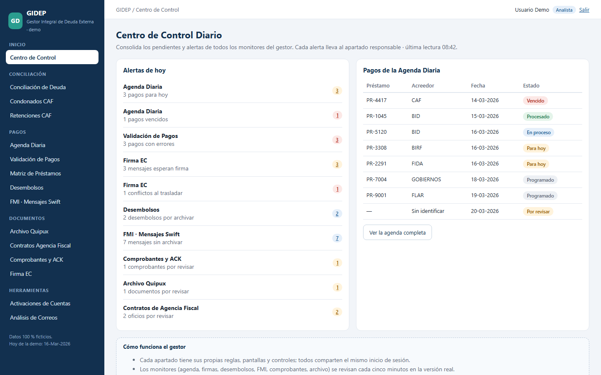
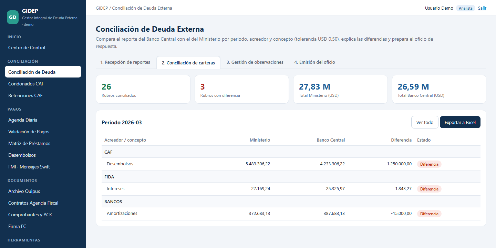
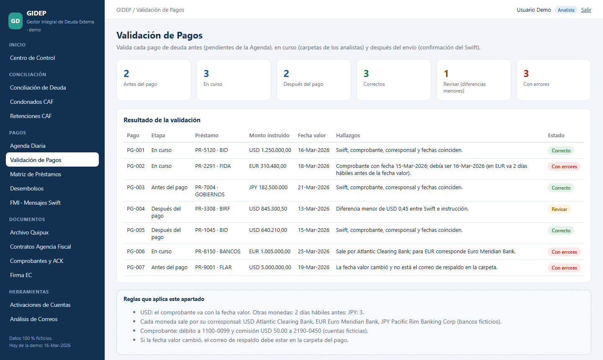
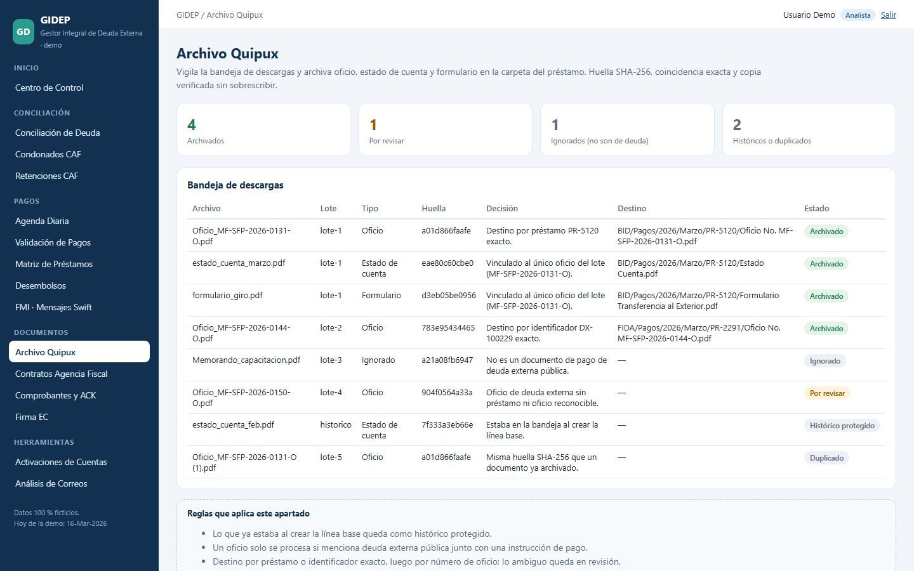
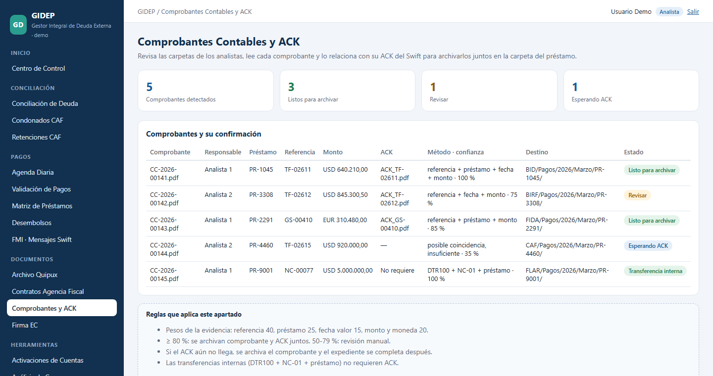
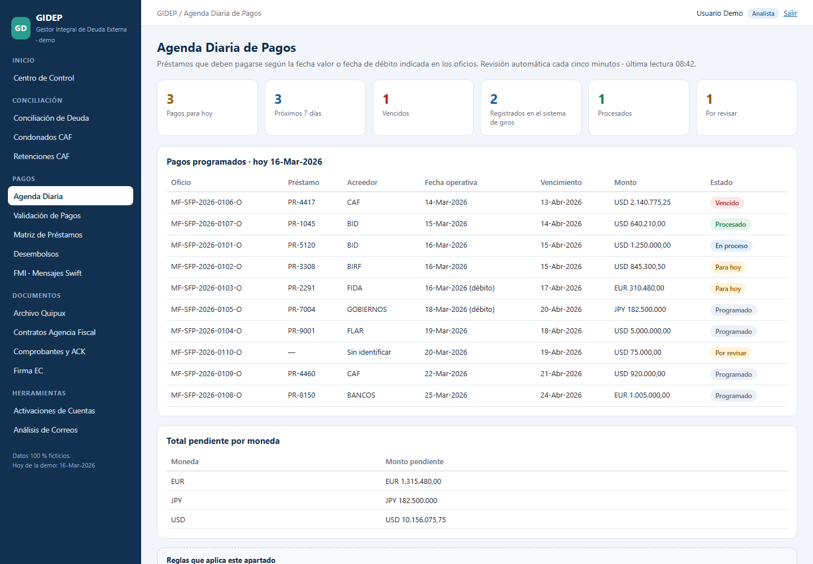
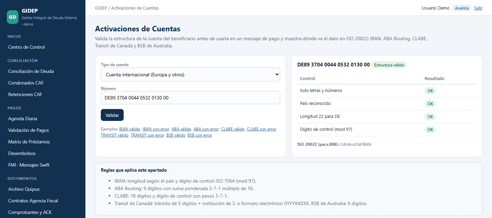
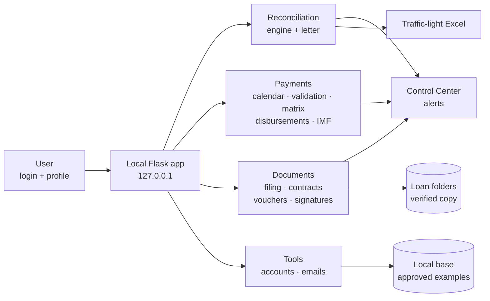

# 🏛️ GIDEP — Integrated Public External Debt Manager

**Python · Flask · SQLite · openpyxl · HTML/CSS** — 🇪🇸 [Versión en español](README.md)

GIDEP is the application I built and use every day at the **Central Bank of Ecuador**, where I work as a Liquidity Operations Analyst, to manage public external debt payments. It brings together in one local manager **15 sections** that used to be manual checks of folders, official letters, SWIFT messages, accounting vouchers and reports: reconciliation with the Ministry of Finance, payment calendar, payment validation, document filing, signatures, account checks and more.

> **Real case, synthetic data.** This repository is a **public demo rebuilt from scratch**: every section applies the same business rules as the institutional version, but on invented data and without any bank paths, names, accounts or documents. The internal version runs locally at the bank and its information is confidential.



---

## 🎯 The problem

External debt operations require cross-checking many sources: Ministry letters, SWIFT messages, acknowledgements (ACK), accounting vouchers, account statements and reports. Before GIDEP this meant:

- Manually going through several folders to know which payments were due today and which documents were missing.
- The risk of filing a voucher or an ACK in the wrong folder.
- Loan references written differently depending on the document.
- Manually following messages waiting for a second signature.
- Reconciliations with the Ministry done in separate tools and steps.

## 🧩 The 15 sections

| Group | Section | What it does | Key control |
|---|---|---|---|
| Home | [Control Center](docs/images/01_centro_control.png) | Consolidates alerts from every monitor | Each alert links to the responsible section |
| Reconciliation | [Debt Reconciliation](docs/images/02_conciliacion.png) | Central Bank vs. Ministry: 9 creditors × 6 concepts | USD 0.50 tolerance · header-based columns · session rule |
| Reconciliation | [Remarks](docs/images/03_observaciones.png) and [Response letter](docs/images/04_oficio.png) | Explains every difference and drafts the reply | Diagnosis from the Ministry's remark |
| Reconciliation | [CAF Forgiven Interest](docs/images/05_condonados_caf.png) | Adds up forgiven interest from statements | Backup before applying · only if it matches |
| Reconciliation | [CAF Withholdings](docs/images/06_retenciones_caf.png) | Monthly withholding for local governments with CAF debt | Signed letter and filed voucher |
| Payments | [Daily Payment Calendar](docs/images/07_agenda_diaria.png) | Payments due according to the letters | Debit date before value date · never assigns by guessing |
| Payments | [Payment Validation](docs/images/08_validacion_pagos.png) | Checks every payment before, during and after sending | SWIFT = instruction · correspondent · date rule by currency |
| Payments | [Loan Payments Matrix](docs/images/09_matriz_prestamos.png) | Logs every transfer by reading the system screen | Added only when all checks are green · no duplicates |
| Payments | [Disbursements](docs/images/10_desembolsos.png) | Detects disbursements in incoming SWIFT messages | Creditor + catalog loan, otherwise review |
| Payments | [IMF · SWIFT messages](docs/images/11_fmi_swift.png) | Classifies IMF messages by process | Interest MT298 filed automatically by quarter |
| Documents | [Document filing](docs/images/12_archivo_quipux.png) | Files letter, statement and transfer form | SHA-256 fingerprint · exact match · never overwrites |
| Documents | [Fiscal Agency Contracts](docs/images/13_contratos_agencia.png) | Files final signed letters of the process | Only a unique match ≥ 99 % |
| Documents | [Vouchers and ACK](docs/images/14_comprobantes_ack.png) | Links each voucher to its SWIFT acknowledgement | Weighted evidence and confidence level |
| Documents | [Electronic signatures](docs/images/15_firma_ec.png) | Tracks messages with one or two signatures | Moves to the day folder and verifies before deleting |
| Tools | [Account activation](docs/images/16_activaciones.png) | Validates IBAN, ABA, CLABE, Transit and BSB | Check-digit algorithms + ISO 20022 mapping |
| Tools | [Email assistant](docs/images/17_correos.png) | Suggests replies from approved examples | Learns locally · no data leaves the computer |

Plus: **login** with hashed passwords, profiles (analyst, supervisor, administrator) and `HttpOnly` / `SameSite` session cookies.

## 🖼️ Some screens

| Reconciliation | Payment validation |
|---|---|
|  |  |
| **Document filing** | **Vouchers and ACK** |
|  |  |
| **Daily calendar** | **Account activation** |
|  |  |

All 17 screenshots are in [`docs/images`](docs/images).

## 🏗️ Architecture



**Design principle:** every section keeps its own rules, screens and controls while sharing the same manager and login. And one rule across all of them: **nothing is filed by guessing**; whatever lacks enough evidence stays in review.

## 📈 How it evolved

| Version | What was added |
|---|---|
| 1 | Console script that reconciles the Bank and Ministry reports into an Excel file. |
| 2 | Local web app (Flask) with SQLite history and traffic-light export. |
| 3–4 | Header-based columns, diagnosis of differences and direct payments. |
| 5 | CAF forgiven interest and reading of ISO 20022 bank notifications. |
| 6–7 | **GIDEP**: calendar, validation, matrix, disbursements, IMF, automatic filing, contracts, vouchers and ACK, signatures, account checks, emails and access control. |

## 🧠 What it shows

- Turning real financial processes (public debt, SWIFT / ISO 20022 cross-border payments, reconciliation) into clear, testable and traceable rules.
- Python for automation: Excel reading, document recognition, weighted-evidence matching, account validators, text similarity.
- A complete web application: Flask, Jinja templates, secure sessions, Excel export and a clean dependency-free UI.
- **25 automated tests** covering access, every screen and the rules of each section.

## ▶️ How to run it

Requirements: Python 3.10+.

```powershell
pip install -r requirements.txt
python scripts/generate_sample_data.py     # synthetic Excel reports for the reconciliation
python scripts/generate_demo_data.py       # synthetic data for the other sections
python -m unittest discover -s tests -v    # 25 tests
python -m gidep                            # opens http://127.0.0.1:5001
```

Sign in with **user `demo` · password `gidep-demo`** (also `supervisor` and `admin`). On Windows you can use `Iniciar.bat`. Another port: `GIDEP_PORT` environment variable.

## 📁 Structure

```
├── gidep/
│   ├── __init__.py          # Flask app: access, menu and routes
│   ├── demo.py              # demo data and helpers
│   ├── modulos/             # one file per section, with its rules documented
│   ├── templates/           # screens (base, login, generic and special)
│   └── static/gidep.css
├── conciliacion/engine.py   # Central Bank vs. Ministry reconciliation engine
├── scripts/                 # synthetic data generators
├── data/                    # demo Excel reports and JSON (synthetic)
├── tests/                   # automated tests
└── docs/images/             # screenshots of the 17 screens
```

## ℹ️ About the data

Everything is **synthetic**: loans, letters, SWIFT messages, ledger accounts, correspondent banks, municipalities and people. Multilateral lender acronyms are used only as generic labels. The demo's "today" is fixed at 16-Mar-2026 so statuses are reproducible. The interface is in Spanish, as in the original manager.

---

👤 **Bryan Andrés Romo Arias** · [GitHub](https://github.com/BryanAndresR23) · [LinkedIn](https://www.linkedin.com/in/bryanromo) · Another project: [SQL + Power BI Portfolio](https://github.com/BryanAndresR23/Portafolio-SQL-PowerBI)
