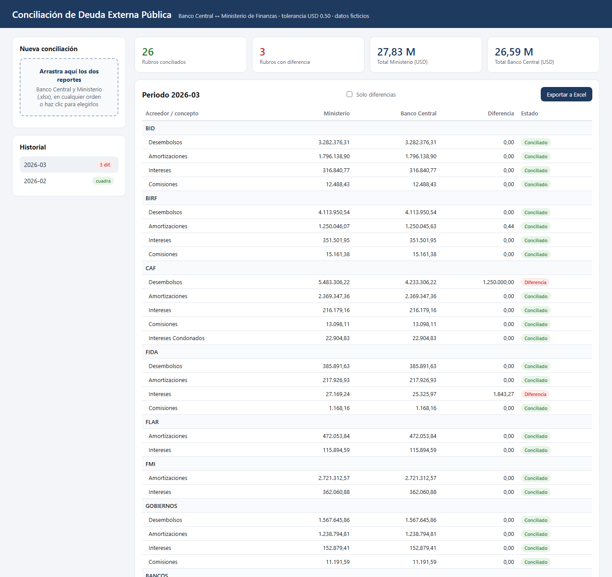
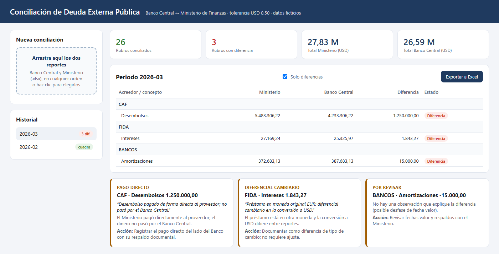
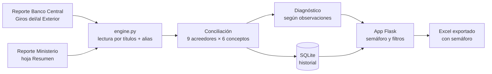

# 🏦 Automatización de la Conciliación de Deuda Externa Pública

**Python · Flask · openpyxl · SQLite** — 🇬🇧 [English version](README.en.md)

Herramienta que concilia cada mes los **pagos de deuda externa pública** registrados por el Banco Central contra el reporte del Ministerio de Finanzas: cruza **9 acreedores × 6 conceptos de pago**, marca con semáforo qué cuadra y explica automáticamente por qué no cuadra lo demás.

> **Caso real, datos ficticios.** Desarrollé esta solución en el **Banco Central del Ecuador**, donde trabajo como Analista de Operaciones de Liquidez, para reemplazar un cruce manual en Excel. Este repositorio es una **versión pública reconstruida**: misma lógica de negocio, pero con reportes inventados y sin rutas, nombres ni datos institucionales. La versión interna corre localmente en el banco y su información es confidencial.



---

## 🎯 El problema

Cada mes hay que demostrar que lo que el Ministerio reporta como servicio de deuda externa (desembolsos, amortizaciones, intereses, comisiones, intereses condonados e intereses por mora) coincide con lo que realmente se movió por el Banco Central. Hacerlo a mano implicaba:

- Abrir dos reportes con formatos distintos y **nombres distintos para el mismo acreedor** (`CORPORACIÓN ANDINA DE FOMENTO - CAF` en uno, `CAF` en el otro).
- Evitar **contar dos veces** los subtotales (el Ministerio trae filas padre como *MULTILATERAL* y además sus hijos).
- Rehacer fórmulas cuando un reporte **movía una columna** de un mes a otro.
- Investigar cada diferencia leyendo observaciones en texto libre.

## ✅ La solución

| Paso | Qué hace |
|---|---|
| 1. Carga | Arrastras los dos reportes en cualquier orden; la app reconoce cuál es del Banco y cuál del Ministerio por sus hojas. |
| 2. Lectura robusta | Cada columna se ubica por su **título**, no por su letra: si el formato cambia, el cruce sigue funcionando. |
| 3. Normalización | Un diccionario de alias traduce los nombres largos del Banco a los códigos del Ministerio y agrupa sub-prestamistas. |
| 4. Conciliación | Por acreedor y concepto: `CONCILIADO` si \|Ministerio − Banco\| ≤ USD 0,50; si no, `DIFERENCIA`. |
| 5. Diagnóstico | Clasifica cada diferencia con la observación del Ministerio: **pago directo**, **diferencial cambiario** o **por revisar** (desfase de fecha), y sugiere la acción. |
| 6. Salida | Tabla con semáforo, historial por periodo en SQLite y exportación a Excel. Los reportes originales **nunca se modifican**. |



## 🏗️ Arquitectura



## 📈 Evolución del proyecto real

El cruce empezó como un script y terminó siendo el **GIDEP — Gestor Integral de Deuda Externa Pública**, la herramienta que uso a diario:

| Versión | Qué se agregó |
|---|---|
| 1 | Script de consola: lee los dos reportes, concilia y genera un Excel con el resultado. |
| 2 | App web local (Flask) con arrastrar y soltar, historial en SQLite y exportación con semáforo. |
| 3–4 | Columnas detectadas por título, diagnóstico automático de diferencias y ajustes por pagos directos. |
| 5 | Módulos de intereses condonados y lectura de notificaciones bancarias ISO 20022. |
| 6–7 | **GIDEP**: agenda de pagos por fecha valor, archivo automático de comprobantes contables y confirmaciones SWIFT, generación de informes y control de acceso por usuario. |

**Resultado:** la conciliación mensual pasó de un cruce manual en Excel a un proceso de segundos, repetible y con trazabilidad, que además explica cada diferencia.

## 🧠 Lo que demuestra

- Traducir un proceso financiero real (deuda pública, pagos internacionales) a reglas de negocio claras y verificables.
- Python para datos: lectura defensiva de Excel, normalización de texto, tolerancias, clasificación.
- Una app web sencilla de punta a punta: API REST con Flask, SQLite y frontend sin dependencias.
- Pruebas automatizadas sobre los casos que importan: alias, subtotales, columnas movidas, tolerancia y diagnóstico.

## ▶️ Cómo ejecutarlo

Requisitos: Python 3.10+.

```powershell
pip install -r requirements.txt
python scripts/generate_sample_data.py      # crea reportes ficticios de feb y mar 2026
python -m unittest discover -s tests -v     # 8 pruebas
python -m conciliacion.app                  # abre http://127.0.0.1:5001
```

En la app, arrastra los dos archivos de `data/sample/` de un mismo mes. También funciona por consola:

```powershell
python -m conciliacion.engine data/sample/Reporte_Banco_Central_2026-03.xlsx data/sample/Reporte_Ministerio_2026-03.xlsx
```

En Windows puedes usar `Iniciar.bat`, que instala lo necesario y abre la app.

## 📁 Estructura

```
├── conciliacion/
│   ├── engine.py              # reglas de negocio: lectura, alias, conciliación, diagnóstico, Excel
│   ├── app.py                 # API y servidor Flask
│   └── templates/index.html   # panel de una sola página
├── scripts/generate_sample_data.py   # reportes ficticios con diferencias sembradas
├── data/sample/               # reportes de ejemplo (febrero cuadra; marzo tiene 3 diferencias)
├── tests/test_engine.py       # pruebas automatizadas
└── docs/images/               # capturas
```

## ℹ️ Sobre los datos

Todos los reportes de `data/sample/` son **ficticios** y se generan con `scripts/generate_sample_data.py`. Los montos, préstamos y sub-prestamistas son inventados; las siglas de organismos multilaterales se usan solo como etiquetas genéricas. Marzo incluye a propósito tres diferencias (un pago directo, un diferencial cambiario y un desfase de fecha) para mostrar el diagnóstico.

---

👤 **Bryan Andrés Romo Arias** · [GitHub](https://github.com/BryanAndresR23) · Otro proyecto: [Portafolio SQL + Power BI](https://github.com/BryanAndresR23/Portafolio-SQL-PowerBI)
