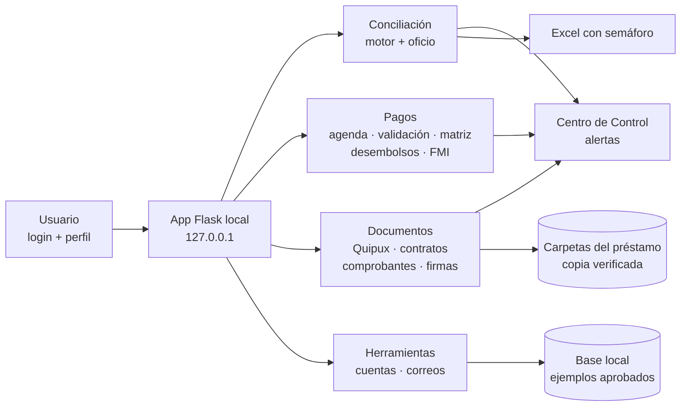

# 🏛️ GIDEP — Gestor Integral de Deuda Externa Pública

**Python · Flask · SQLite · openpyxl · HTML/CSS** — 🇬🇧 [English version](README.en.md)

GIDEP es la aplicación que construí y uso a diario en el **Banco Central del Ecuador**, donde trabajo como Analista de Operaciones de Liquidez, para gestionar los pagos de deuda externa pública. Reúne en un solo gestor local **15 apartados** que antes eran revisiones manuales de carpetas, oficios, mensajes Swift, comprobantes y reportes: conciliación con el Ministerio de Finanzas, agenda de pagos, validación, archivo documental, firmas, cuentas y más.

> **Caso real, datos ficticios.** Este repositorio es una **demo pública reconstruida desde cero**: cada apartado aplica las mismas reglas de negocio que la versión institucional, pero sobre datos inventados y sin rutas, nombres, cuentas ni documentos del banco. La versión interna corre localmente en el banco y su información es confidencial.


---

## 🎯 El problema

La operación de deuda externa obliga a cruzar información de muchas fuentes: oficios del Ministerio, mensajes Swift, confirmaciones (ACK), comprobantes contables, estados de cuenta y reportes. Antes de GIDEP eso implicaba:

- Revisar a mano varias carpetas para saber qué pagos tocaban hoy y qué documentos faltaban.
- Riesgo de archivar un comprobante o un ACK en la carpeta equivocada.
- Referencias de préstamo escritas de formas distintas según el documento.
- Seguir a mano los mensajes pendientes de segunda firma.
- Conciliaciones con el Ministerio hechas en herramientas y pasos separados.

## 🧩 Los 15 apartados

| Grupo | Apartado | Qué hace | Control clave |
|---|---|---|---|
| Inicio | [Centro de Control](docs/images/01_centro_control.png) | Consolida las alertas de todos los monitores | Cada alerta lleva al apartado responsable |
| Conciliación | [Conciliación de Deuda](docs/images/02_conciliacion.png) | Cruza Banco Central vs. Ministerio: 9 acreedores × 6 conceptos | Tolerancia USD 0,50 · columnas por título · regla de sesión |
| Conciliación | [Observaciones](docs/images/03_observaciones.png) y [Oficio](docs/images/04_oficio.png) | Explica cada diferencia y redacta el oficio de respuesta | Diagnóstico según la observación del Ministerio |
| Conciliación | [Condonados CAF](docs/images/05_condonados_caf.png) | Suma intereses condonados de los estados de cuenta | Respaldo antes de aplicar · solo si coincide |
| Conciliación | [Retenciones CAF](docs/images/06_retenciones_caf.png) | Retención mensual de gobiernos locales con deuda CAF | Firma del oficio y comprobante archivado |
| Pagos | [Agenda Diaria](docs/images/07_agenda_diaria.png) | Pagos del día según los oficios | Fecha de débito antes que fecha valor · no asigna por suposición |
| Pagos | [Validación de Pagos](docs/images/08_validacion_pagos.png) | Revisa cada pago antes, durante y después del envío | Swift = instrucción · corresponsal · regla de fechas por moneda |
| Pagos | [Matriz de Préstamos](docs/images/09_matriz_prestamos.png) | Registra cada giro leyendo la pantalla del sistema | Solo agrega si todo está en verde · sin duplicados |
| Pagos | [Desembolsos](docs/images/10_desembolsos.png) | Detecta desembolsos en los Swift entrantes | Acreedor + préstamo del catálogo, si no, revisión |
| Pagos | [FMI · Mensajes Swift](docs/images/11_fmi_swift.png) | Clasifica los mensajes del FMI por proceso | MT298 de intereses se archiva solo por trimestre |
| Documentos | [Archivo Quipux](docs/images/12_archivo_quipux.png) | Archiva oficio, estado de cuenta y formulario | Huella SHA-256 · coincidencia exacta · nunca sobrescribe |
| Documentos | [Contratos de Agencia Fiscal](docs/images/13_contratos_agencia.png) | Archiva oficios finales firmados del proceso | Solo coincidencia única ≥ 99 % |
| Documentos | [Comprobantes y ACK](docs/images/14_comprobantes_ack.png) | Relaciona cada comprobante con su confirmación Swift | Evidencia ponderada y nivel de confianza |
| Documentos | [Firma EC](docs/images/15_firma_ec.png) | Controla mensajes con una o dos firmas | Traslada al día y verifica antes de borrar de origen |
| Herramientas | [Activaciones de Cuentas](docs/images/16_activaciones.png) | Valida IBAN, ABA, CLABE, Transit y BSB | Algoritmos de control + mapeo ISO 20022 |
| Herramientas | [Análisis de Correos](docs/images/17_correos.png) | Sugiere respuestas a partir de ejemplos aprobados | Aprende localmente · no envía datos fuera |

Además: **inicio de sesión** con contraseñas en hash, perfiles (analista, supervisor, administrador) y cookies de sesión `HttpOnly` / `SameSite`.

## 🖼️ Algunas pantallas

| Conciliación de carteras | Validación de pagos |
|---|---|
|  |  |
| **Archivo Quipux** | **Comprobantes y ACK** |
|  |  |
| **Agenda diaria** | **Activaciones de cuentas** |
|  |  |

Las 17 capturas están en [`docs/images`](docs/images).

## 🏗️ Arquitectura



**Principio de diseño:** cada apartado tiene sus propias reglas, pantallas y controles; todos comparten el mismo gestor y el mismo inicio de sesión. Y una regla transversal: **nada se archiva por suposición**; lo que no tiene evidencia suficiente queda en revisión.

## 📈 Cómo evolucionó

| Versión | Qué se agregó |
|---|---|
| 1 | Script de consola que concilia los reportes del Banco y del Ministerio y genera un Excel. |
| 2 | App web local (Flask) con historial en SQLite y exportación con semáforo. |
| 3–4 | Columnas detectadas por título, diagnóstico de diferencias y pagos directos. |
| 5 | Condonados CAF y lectura de notificaciones bancarias ISO 20022. |
| 6–7 | **GIDEP**: agenda, validación, matriz, desembolsos, FMI, archivo automático, contratos, comprobantes y ACK, firmas, activaciones, correos y control de acceso. |

## 🧠 Lo que demuestra

- Convertir procesos financieros reales (deuda pública, pagos internacionales SWIFT/ISO 20022, conciliación) en reglas claras, verificables y con trazabilidad.
- Python para automatización: lectura de Excel, reconocimiento de documentos, coincidencias con evidencia ponderada, validadores de cuentas, similitud de texto.
- Una aplicación web completa: Flask, plantillas Jinja, sesiones seguras, exportación a Excel y una interfaz limpia sin dependencias de frontend.
- **25 pruebas automatizadas** que cubren acceso, todas las pantallas y las reglas de cada apartado.

## ▶️ Cómo ejecutarlo

Requisitos: Python 3.10+.

```powershell
pip install -r requirements.txt
python scripts/generate_sample_data.py     # reportes Excel ficticios para la conciliación
python scripts/generate_demo_data.py       # datos ficticios de los demás apartados
python -m unittest discover -s tests -v    # 25 pruebas
python -m gidep                            # abre http://127.0.0.1:5001
```

Entra con **usuario `demo` · contraseña `gidep-demo`** (también `supervisor` y `admin`). En Windows puedes usar `Iniciar.bat`. Para otro puerto: variable `GIDEP_PORT`.

## 📁 Estructura

```
├── gidep/
│   ├── __init__.py          # app Flask: acceso, menú y rutas
│   ├── demo.py              # datos de la demo y utilidades
│   ├── modulos/             # un archivo por apartado, con sus reglas documentadas
│   ├── templates/           # pantallas (base, login, genérica y especiales)
│   └── static/gidep.css
├── conciliacion/engine.py   # motor de conciliación Banco Central vs. Ministerio
├── scripts/                 # generadores de datos ficticios
├── data/                    # reportes Excel y JSON de la demo (ficticios)
├── tests/                   # pruebas automatizadas
└── docs/images/             # capturas de las 17 pantallas
```

## ℹ️ Sobre los datos

Todo es **ficticio**: préstamos, oficios, mensajes Swift, cuentas contables, bancos corresponsales, municipios y personas. Las siglas de organismos multilaterales se usan solo como etiquetas genéricas. La "fecha de hoy" de la demo está fija en el 16-mar-2026 para que los estados sean reproducibles. La interfaz está en español, como el gestor original.

---

👤 **Bryan Andrés Romo Arias** · [GitHub](https://github.com/BryanAndresR23) · [LinkedIn](https://www.linkedin.com/in/bryanromo) · Otro proyecto: [Portafolio SQL + Power BI](https://github.com/BryanAndresR23/Portafolio-SQL-PowerBI)
